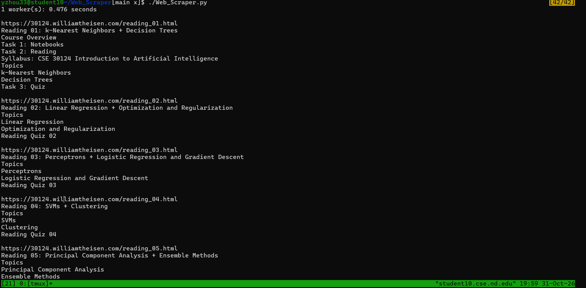
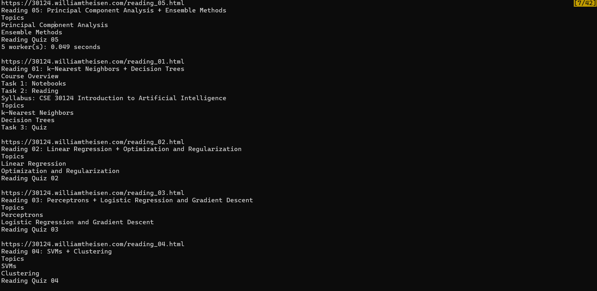
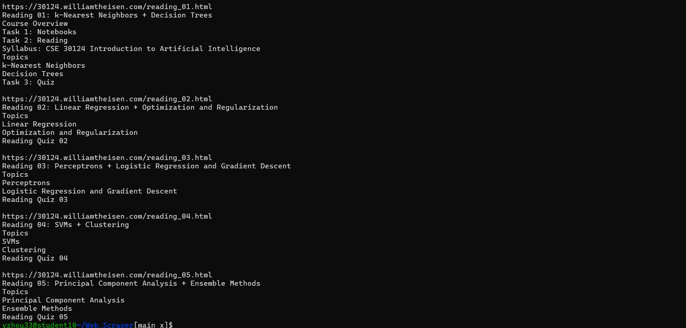

## How to use:

    1) pip install -r requirements.txt
    2) chmod +x Web_Scraper.py
    3) ./Web_Scraper.py

## Performace impact:

The scraper uses functional programming through `map()` and `lambda` to process HTML headings. These functions simplify the code but do not necessarily improve execution speed.

The scraper also uses `concurrent.futures.ThreadPoolExecutor` to request multiple webpages concurrently. Since web scraping is I/O-bound, multiple threads can reduce the time spent waiting for network responses.

### Results

| Workers | Execution Time |
|---|---|
| 1 | 0.476 seconds |
| 5 | 0.049 seconds |

In this test, using five workers was approximately **9.71 times faster**, reducing execution time by **89.7%**.

However, this result may also network variability. Multiple trials would provide a more reliable performance comparison.

## Screenshot
## Screenshots

### 1 Worker

### 5 Workers

### Additional Output

